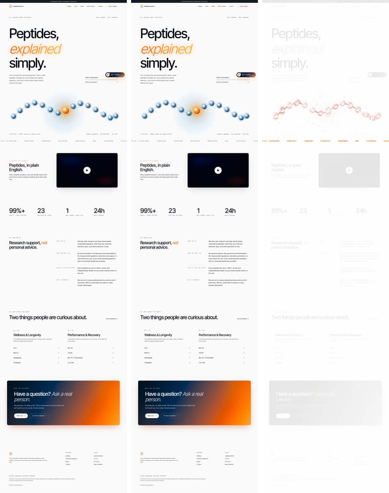
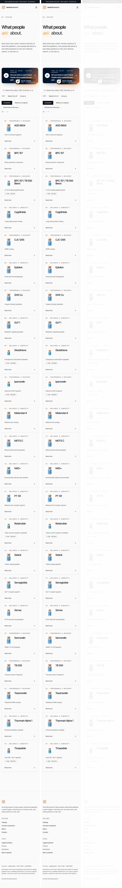

# Visual Regression Report

The original site and the reconstruction were compared on **2026-10-27**. The comparison covered **35 routes** at **5 viewport widths** (1440, 1024, 768, 390, 375 px), for **175 full-page screenshots**, plus 9 interactive states.

## Method

- **Capture tool:** `tests/visual/shoot.mjs` (Playwright, Chromium), run on the same machine against both sites.
- **Original:** https://socalbioresearch.org (live).
- **Reconstruction:** a local production build (`next build && next start`).
- **Captured state:** the age gate and chat teaser were dismissed through storage, the same as for a returning visitor. Each page was scrolled top to bottom to trigger the reveal animations. The capture then waited 4.5 s so the hero word cycle and count-ups could settle, paused the video at frame 0, and froze CSS animations.
- **Comparison tool:** `tests/visual/compare.mjs`, using pixelmatch with threshold 0.1 and anti-aliasing ignored. **Diff %** is the share of all page pixels that differ.
- **Interactive states:** `tests/visual/states.mjs` (viewport screenshots).

## Results

| Width | Pages | Page-height mismatches | Average diff % | Worst page |
|---|---|---|---|---|
| 1440 | 35 | **0** | 0.007 | home@1440 (0.127%) |
| 1024 | 35 | **0** | 0.008 | home@1024 (0.094%) |
| 768 | 35 | **0** | 0.008 | home@768 (0.078%) |
| 390 | 35 | **0** | 0.005 | home@390 (0.074%) |
| 375 | 35 | **0** | 0.003 | home@375 (0.057%) |

**Every page renders at exactly the original height at every width.** This means the reconstruction matches the original's text wrapping, spacing and section sizes everywhere. Of the 175 screenshots, the largest pixel difference is 0.127%.

### Where the remaining differences come from

All remaining differences come from animations that cannot repeat exactly. They also occur between two loads of the original.

- **Home hero molecule:** particle positions and drift are randomized with `Math.random()` on each load.
- **Product marquee:** it scrolls continuously, so its offset depends on how long the page has been open.
- **"Ask Dr. Peptide" button:** its pulse ring animates continuously, so each capture freezes it at a different frame.

### Interactive states

| State | Diff % |
|---|---|
| age-gate@1440 | 0 |
| age-gate@390 | 0 |
| age-gate-under21@1440 | 0 |
| chat-teaser@1440 | 0 |
| chat-open@1440 | 0 |
| chat-open@390 | 0 |
| mobile-menu@390 | 0 |
| contact-errors@1440 | 0 |
| scrolled-header@1440 | 0 |

## Per-route results (diff %)

| Route | 1440 | 1024 | 768 | 390 | 375 |
|---|---|---|---|---|---|
| `/about` | 0 | 0 | 0.002 | 0.014 | 0 |
| `/contact` | 0 | 0.001 | 0.004 | 0.008 | 0 |
| `/` | 0.127 | 0.094 | 0.078 | 0.074 | 0.057 |
| `/legal` | 0.003 | 0.004 | 0.011 | 0.007 | 0.016 |
| `/legal/acceptable-use` | 0.001 | 0 | 0.001 | 0 | 0 |
| `/legal/disclaimer` | 0 | 0 | 0.001 | 0 | 0 |
| `/legal/privacy` | 0 | 0 | 0 | 0 | 0 |
| `/legal/shipping` | 0 | 0 | 0.002 | 0 | 0 |
| `/legal/terms` | 0 | 0 | 0 | 0 | 0 |
| `/new-customer` | 0.002 | 0 | 0.004 | 0 | 0.002 |
| `/products` | 0.013 | 0 | 0 | 0 | 0 |
| `/products/aod-9604` | 0.004 | 0.006 | 0.007 | 0 | 0 |
| `/products/bpc-157-tb-500-blend` | 0.002 | 0 | 0 | 0.004 | 0.001 |
| `/products/bpc-157` | 0.004 | 0.005 | 0.007 | 0 | 0 |
| `/products/cagrilintide` | 0.005 | 0.006 | 0.007 | 0 | 0 |
| `/products/cjc-1295` | 0.005 | 0.017 | 0.007 | 0 | 0 |
| `/products/epitalon` | 0.01 | 0.006 | 0.007 | 0 | 0 |
| `/products/ghk-cu` | 0.005 | 0.016 | 0.007 | 0 | 0 |
| `/products/glp-1` | 0 | 0.003 | 0.003 | 0 | 0 |
| `/products/glutathione` | 0 | 0 | 0 | 0 | 0 |
| `/products/ipamorelin` | 0 | 0.018 | 0.021 | 0 | 0 |
| `/products/melanotan-ii` | 0.004 | 0.02 | 0.007 | 0.044 | 0 |
| `/products/mots-c` | 0.004 | 0.007 | 0.007 | 0 | 0 |
| `/products/nad-plus` | 0.007 | 0.009 | 0.011 | 0 | 0 |
| `/products/pt-141` | 0.004 | 0.005 | 0.018 | 0 | 0 |
| `/products/retatrutide` | 0.002 | 0.001 | 0 | 0 | 0.001 |
| `/products/selank` | 0.01 | 0.007 | 0.007 | 0 | 0 |
| `/products/semaglutide` | 0.002 | 0.005 | 0.006 | 0 | 0 |
| `/products/semax` | 0.004 | 0.007 | 0.007 | 0 | 0 |
| `/products/sermorelin` | 0.005 | 0.006 | 0.007 | 0 | 0 |
| `/products/tb-500` | 0.004 | 0.005 | 0.005 | 0 | 0 |
| `/products/tesamorelin` | 0.004 | 0.016 | 0.019 | 0 | 0.001 |
| `/products/thymosin-alpha-1` | 0.004 | 0.007 | 0.007 | 0 | 0 |
| `/products/tirzepatide` | 0.013 | 0 | 0.02 | 0.002 | 0.001 |
| `/research` | 0 | 0.001 | 0 | 0.016 | 0.016 |

## Side-by-side images

Each image shows three columns: **original | reconstruction | diff**. In the diff column, red marks pixels that differ. Images are provided at 1440 px and 390 px. To produce all five widths at full resolution, with an HTML report, run:

```bash
node tests/visual/shoot.mjs https://socalbioresearch.org tests/visual/output/original
node tests/visual/shoot.mjs http://localhost:3000 tests/visual/output/recon
node tests/visual/compare.mjs tests/visual/output/original tests/visual/output/recon tests/visual/output/compare
open tests/visual/output/compare/report.html
```

- `/about`: [1440](visual-report/about@1440.jpg) · [390](visual-report/about@390.jpg)
- `/contact`: [1440](visual-report/contact@1440.jpg) · [390](visual-report/contact@390.jpg)
- `/`: [1440](visual-report/home@1440.jpg) · [390](visual-report/home@390.jpg)
- `/legal`: [1440](visual-report/legal@1440.jpg) · [390](visual-report/legal@390.jpg)
- `/legal/acceptable-use`: [1440](visual-report/legal__acceptable-use@1440.jpg) · [390](visual-report/legal__acceptable-use@390.jpg)
- `/legal/disclaimer`: [1440](visual-report/legal__disclaimer@1440.jpg) · [390](visual-report/legal__disclaimer@390.jpg)
- `/legal/privacy`: [1440](visual-report/legal__privacy@1440.jpg) · [390](visual-report/legal__privacy@390.jpg)
- `/legal/shipping`: [1440](visual-report/legal__shipping@1440.jpg) · [390](visual-report/legal__shipping@390.jpg)
- `/legal/terms`: [1440](visual-report/legal__terms@1440.jpg) · [390](visual-report/legal__terms@390.jpg)
- `/new-customer`: [1440](visual-report/new-customer@1440.jpg) · [390](visual-report/new-customer@390.jpg)
- `/products`: [1440](visual-report/products@1440.jpg) · [390](visual-report/products@390.jpg)
- `/products/aod-9604`: [1440](visual-report/products__aod-9604@1440.jpg) · [390](visual-report/products__aod-9604@390.jpg)
- `/products/bpc-157-tb-500-blend`: [1440](visual-report/products__bpc-157-tb-500-blend@1440.jpg) · [390](visual-report/products__bpc-157-tb-500-blend@390.jpg)
- `/products/bpc-157`: [1440](visual-report/products__bpc-157@1440.jpg) · [390](visual-report/products__bpc-157@390.jpg)
- `/products/cagrilintide`: [1440](visual-report/products__cagrilintide@1440.jpg) · [390](visual-report/products__cagrilintide@390.jpg)
- `/products/cjc-1295`: [1440](visual-report/products__cjc-1295@1440.jpg) · [390](visual-report/products__cjc-1295@390.jpg)
- `/products/epitalon`: [1440](visual-report/products__epitalon@1440.jpg) · [390](visual-report/products__epitalon@390.jpg)
- `/products/ghk-cu`: [1440](visual-report/products__ghk-cu@1440.jpg) · [390](visual-report/products__ghk-cu@390.jpg)
- `/products/glp-1`: [1440](visual-report/products__glp-1@1440.jpg) · [390](visual-report/products__glp-1@390.jpg)
- `/products/glutathione`: [1440](visual-report/products__glutathione@1440.jpg) · [390](visual-report/products__glutathione@390.jpg)
- `/products/ipamorelin`: [1440](visual-report/products__ipamorelin@1440.jpg) · [390](visual-report/products__ipamorelin@390.jpg)
- `/products/melanotan-ii`: [1440](visual-report/products__melanotan-ii@1440.jpg) · [390](visual-report/products__melanotan-ii@390.jpg)
- `/products/mots-c`: [1440](visual-report/products__mots-c@1440.jpg) · [390](visual-report/products__mots-c@390.jpg)
- `/products/nad-plus`: [1440](visual-report/products__nad-plus@1440.jpg) · [390](visual-report/products__nad-plus@390.jpg)
- `/products/pt-141`: [1440](visual-report/products__pt-141@1440.jpg) · [390](visual-report/products__pt-141@390.jpg)
- `/products/retatrutide`: [1440](visual-report/products__retatrutide@1440.jpg) · [390](visual-report/products__retatrutide@390.jpg)
- `/products/selank`: [1440](visual-report/products__selank@1440.jpg) · [390](visual-report/products__selank@390.jpg)
- `/products/semaglutide`: [1440](visual-report/products__semaglutide@1440.jpg) · [390](visual-report/products__semaglutide@390.jpg)
- `/products/semax`: [1440](visual-report/products__semax@1440.jpg) · [390](visual-report/products__semax@390.jpg)
- `/products/sermorelin`: [1440](visual-report/products__sermorelin@1440.jpg) · [390](visual-report/products__sermorelin@390.jpg)
- `/products/tb-500`: [1440](visual-report/products__tb-500@1440.jpg) · [390](visual-report/products__tb-500@390.jpg)
- `/products/tesamorelin`: [1440](visual-report/products__tesamorelin@1440.jpg) · [390](visual-report/products__tesamorelin@390.jpg)
- `/products/thymosin-alpha-1`: [1440](visual-report/products__thymosin-alpha-1@1440.jpg) · [390](visual-report/products__thymosin-alpha-1@390.jpg)
- `/products/tirzepatide`: [1440](visual-report/products__tirzepatide@1440.jpg) · [390](visual-report/products__tirzepatide@390.jpg)
- `/research`: [1440](visual-report/research@1440.jpg) · [390](visual-report/research@390.jpg)

### Examples





## Other verification run on the final build

| Check | Script | Result |
|---|---|---|
| Interactive behavior: age gate, header, mobile menu, search, prefill, contact form, Dr. Peptide streaming and handoff, FAQ, 404, admin protection | `tests/functional.mjs` | 10/10 pass |
| Internal links, images, assets and console errors on all 35 routes | `tests/links.mjs` | 64 links OK, no broken images, no console errors |
| SEO metadata (title, description, canonical, og:*, twitter:*, JSON-LD) against the original | `tests/seo.mjs` | Identical on all 35 routes |
| Accessibility (axe, WCAG 2 A/AA) against the original | `tests/a11y.mjs` | No new issues. One pre-existing issue fixed invisibly (the closed chat panel is now `inert`). |
| Database migrations and RLS policies | `tests/db-policies.mjs` | 12/12 pass |
| Dr. Peptide streaming bridge | Mock Anthropic endpoint | Correct OpenAI-format SSE. The greeting is dropped before the API call, and the fallback and effort settings are sent. |
